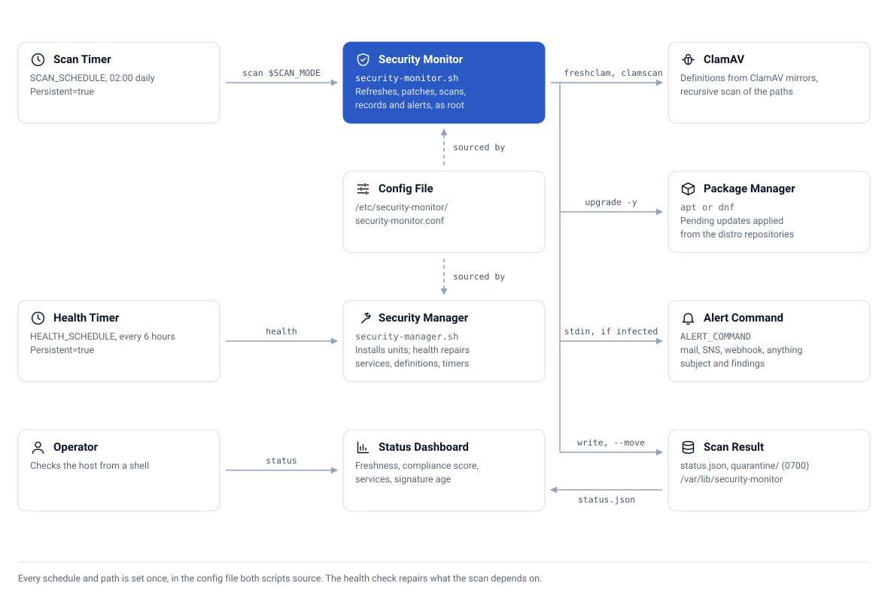
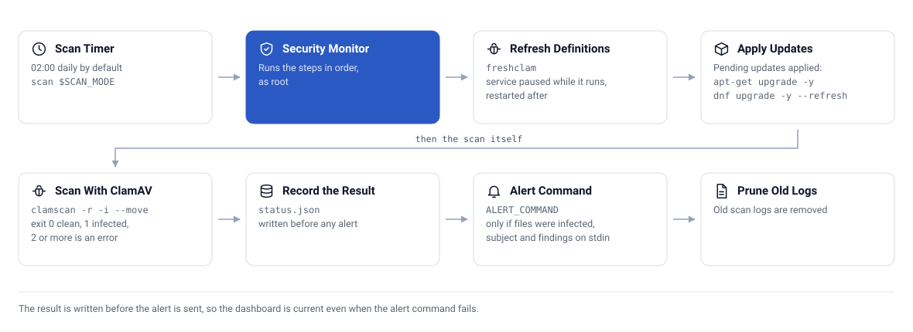

# 🧠 How it works

Two Bash scripts and two systemd timers. There is no daemon of its own and no network service.

## The pieces

| Piece | Job |
|---|---|
| `security-monitor` | Refreshes definitions, applies package updates, scans, writes the result, alerts, and draws the dashboard |
| `security-manager` | Installs and removes everything, and runs the health check |
| `security-monitor.conf` | The one config file both scripts source |
| `security-monitor-scan.timer` | Runs `security-monitor scan $SCAN_MODE` on `SCAN_SCHEDULE` |
| `security-monitor-health.timer` | Runs `security-manager health` on `HEALTH_SCHEDULE` |

Both timers use `Persistent=true`, so a run missed while the instance was stopped happens at the next boot. The scan timer adds `RandomizedDelaySec=15m` so a fleet does not scan in lockstep, and the scan service runs at `Nice=10` with idle I/O priority.

<picture>
  <source media="(prefers-color-scheme: dark)" srcset="assets/architecture-dark.svg">
  
</picture>

## One scan

1. `freshclam` refreshes the signatures, with the freshclam service paused so it cannot hold the database lock.
2. Pending package updates are applied with `apt` or `dnf`, and the script counts what was applied and what is still available.
3. `clamscan` runs over the quick or full paths, skipping paths that do not exist and excluding `/sys`, `/proc`, `/dev`, the quarantine directory, `.git`, `node_modules` and `.cache`. With `QUARANTINE_ENABLED="yes"`, infected files are moved, never deleted.
4. The exit code decides the result: 0 is `clean`, 1 is `attention`, 2 or higher is `error`.
5. `status.json` is written before any alert is sent, so the dashboard is current even if the alert command fails.
6. If files were infected, `ALERT_COMMAND` runs with the findings on stdin.
7. Scan logs older than `LOG_RETENTION_DAYS` are deleted.

<picture>
  <source media="(prefers-color-scheme: dark)" srcset="assets/scan-sequence-dark.svg">
  
</picture>

## The dashboard

`security-monitor status` reads `status.json` and the live system. The compliance score is five checks worth 20 points each: no infected files, scan timer active, a scan within `SCAN_MAX_AGE_HOURS`, signatures within `DB_MAX_AGE_DAYS`, and automatic updates enabled. When a value cannot be determined it says `unknown` instead of guessing.

`status.json` is mode `0644`, which is why the dashboard works without root. It holds counts and timestamps only.

## The health check

`security-manager health` runs every `HEALTH_SCHEDULE` and repairs what it can: the freshclam service, the ClamAV daemon, signatures older than `DB_MAX_AGE_DAYS`, stopped timers, and missing scripts, config or shortcuts. It prints how many checks needed attention.

## What it touches

[SECURITY.md](../SECURITY.md) lists every file and setting the installer changes. In short: it runs as root, applies updates unattended, rewrites the ClamAV and automatic-update config, and moves infected files into a `0700` quarantine directory.
