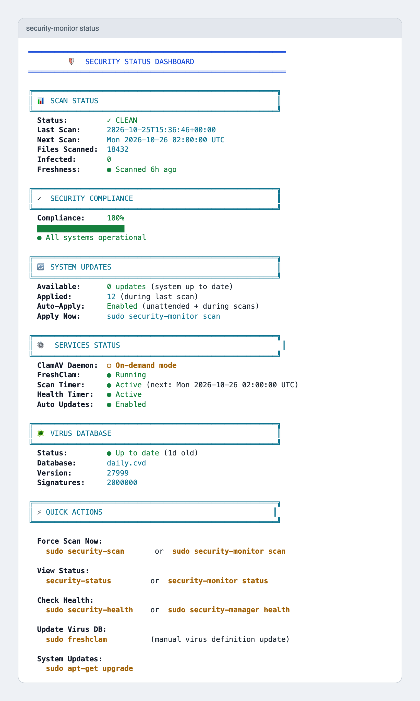

# 🚀 Setup

This walks through a first install on one server, from a clean shell to a first scan.

## Before you start

- A Linux server running systemd: Ubuntu, Debian or Amazon Linux 2023. The installer refuses anything else.
- Root access (`sudo`).
- Outbound internet access, to download ClamAV packages and virus definitions.
- Bash 4.0 or newer, which every supported distribution ships.

The tool installs ClamAV, `jq`, `curl` and the distribution's automatic-update package, and it overwrites the ClamAV and automatic-update configuration. Read [SECURITY.md](../SECURITY.md) first on a server you care about.

## 1. Get the scripts

```bash
git clone https://github.com/CaputoDavide93/EC2-Linux-Security-Monitor.git
cd EC2-Linux-Security-Monitor
less security-monitor.sh security-manager.sh    # both run as root, so read them
chmod +x security-monitor.sh security-manager.sh
```

## 2. Run the installer

```bash
sudo ./security-manager.sh install
```

The installer runs these steps in order: update package lists, install ClamAV and its tools, configure ClamAV, configure automatic updates, install the config file, set up log rotation, copy both scripts to `/usr/local/bin`, create the systemd timers, and create shell shortcuts.

It never overwrites an existing `/etc/security-monitor/security-monitor.conf`. Upgrading from v2.x replaces the old `/etc/cron.d/security-monitor` with systemd timers.

## 3. Load the shortcuts

```bash
source /etc/profile.d/security-monitor.sh
```

New shells pick them up on their own. The shortcuts are `security-scan`, `security-status` and `security-health`.

## 4. Run the first scan

```bash
sudo security-monitor scan
```

A quick scan checks `/home` and `/root` and takes 30 to 90 seconds on a small instance. It also runs `freshclam` and applies pending package updates first, so the first run can take longer.

## 5. Read the dashboard

```bash
security-monitor status
```

No `sudo` needed. A healthy host shows a clean scan, a compliance score of 100%, both timers active and signatures under seven days old.

<picture>
  <source media="(prefers-color-scheme: dark)" srcset="assets/screenshots/dashboard-dark.png">
  
</picture>

The screenshot is the real dashboard on demo data, retaken with `make screenshots`.

## 6. Set up alerts

Alerts are off until you set `ALERT_COMMAND` in `/etc/security-monitor/security-monitor.conf`. The command receives the subject line and the findings on stdin, and runs only when a scan finds infected files.

```bash
sudo nano /etc/security-monitor/security-monitor.conf
```

Test the whole path with the EICAR test file, which every ClamAV install flags as a harmless test signature:

```bash
printf 'X5O!P%%@AP[4\\PZX54(P^)7CC)7}$EICAR-STANDARD-ANTIVIRUS-TEST-FILE!$H+H*' > /root/eicar.txt
sudo security-monitor scan
sudo ls /var/lib/security-monitor/quarantine
```

Remove the quarantined test file afterwards: `sudo rm /var/lib/security-monitor/quarantine/eicar.txt`.

## Changing a schedule

Edit `SCAN_SCHEDULE`, `HEALTH_SCHEDULE` or `SCAN_MODE` in the config file, then run `sudo security-manager install` again to rewrite the timer units. Check the syntax first with `systemd-analyze calendar "*-*-* 02:00:00"`.

## Removing it

```bash
sudo security-manager uninstall
```

This removes the timers, scripts, config, data and logs, and warns first if anything is still quarantined. The ClamAV packages stay installed.
